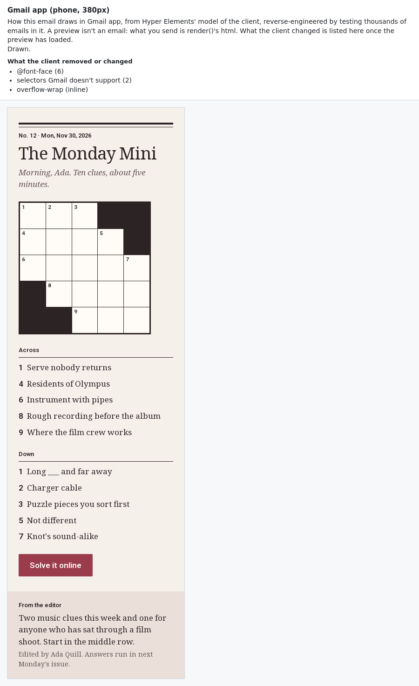
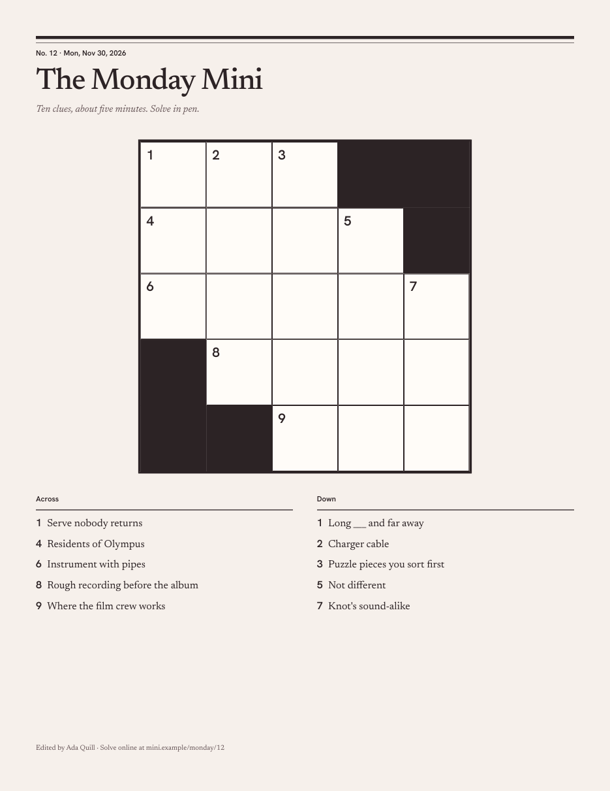
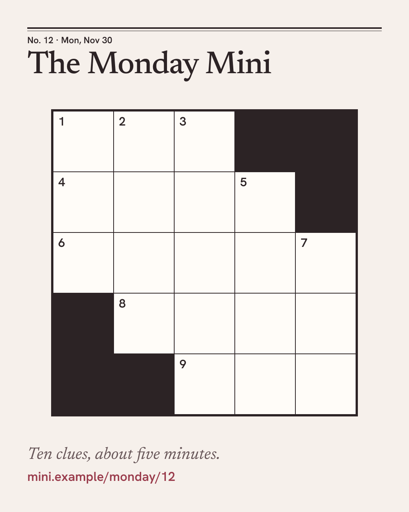

# Crossword Kit

A newsletter crossword that actually works in an inbox. Write the puzzle once as a grid of letters and ten clues, and get:

- **An email** where the grid is real table cells, so it draws the same in classic Outlook, Gmail and Apple Mail, with a "Solve it online" button
- **A print PDF**: the puzzle on page one, the answer key on page two
- **A share card** (1080 × 1350 PNG and SVG) for a group chat or a story

All three are built with [Hyper Elements](https://hyperelements.dev) (`@hyper-elements/react`) and share one grid element.

| Email, classic Outlook | Email, Gmail app | PDF puzzle | PDF answer key | Share card |
|---|---|---|---|---|
|  |  |  |  |  |

The email screenshots come from Hyper Elements' email-client emulator (`@hyper-elements/email-clients`).

## Why

Most newsletter puzzles are a screenshot and a link, because a crossword is hard to build in email: no CSS grid, no absolute positioning, and Outlook draws with Word. A grid of table cells is the one layout every client agrees on. The hard part is the little clue number in each square's corner, and that holds up in every client tested.

## Write a puzzle

```ts
// src/data.ts
grid: ["ACE##", "GODS#", "ORGAN", "#DEMO", "##SET"],
clues: {
  across: { 1: "Serve nobody returns", 4: "Residents of Olympus", /* … */ },
  down:   { 1: "Long ___ and far away", 2: "Charger cable", /* … */ },
},
```

`#` is a block. You never number anything: `src/grid.ts` numbers the squares the standard way (a square starts an entry when the square before it is a block or the edge), and reads each answer out of the grid. A clue can't point at the wrong square, and the answer key can't disagree with the puzzle. Any rectangular grid works, not only 5 × 5.

## The look

A weekend paper's puzzle page: warm off-white paper (`#f6f0eb`), brown-black ink for type and blocks (`#2c2325`), answer squares a step lighter than the paper, and one deep rose (`#9a3c4c`) for the one thing to do, solving online. Newsreader, a text serif drawn for news, sets the title and clues; Hanken Grotesk sets the small numbers and labels. A heavy rule over a thin one heads every output, as a newspaper masthead does. Contrast on the paper: ink 13.5:1, the muted grey 6.2:1, rose 6.0:1.

## How Hyper Elements is used

| Feature | Where | What it does here |
|---|---|---|
| `defineTheme` + `Register` | `src/theme.ts` | One typed theme: every `token()` and `apply` name is checked by `tsc` |
| `formats` | `src/theme.ts` | Body, clue and heading sizes per root (print, email, canvas), so no root restyles by hand |
| Named styles | `src/theme.ts` | `label`, `number`, `muted`, `standfirst`, shared by all three outputs |
| Shared grid | `src/elements.tsx` | `CrosswordGrid` is `Table`, `TableRow` and `TableCell`, sized by one `cell` prop: 56px in email, 88px in the PDF, 48px on the answer key, 160px on the card |
| `defineElement` | `src/elements.tsx` | `ClueList` is a custom element with typed props (a list of number, clue and answer), used in the email and both PDF pages |
| `MergeTag` | `src/email.tsx` | "Morning, {{first_name}}." for your sending service to fill |
| Scoped `tokens` | `src/email.tsx` | The editor's note band swaps the background token instead of restyling its children |
| `Email` + `Button` hover | `src/email.tsx` | 600px email, clues side by side on desktop and stacked on phones |
| `render` + `emailClients()` | `scripts/render-email.tsx` | Renders once and checks the email against 11 clients |
| `renderInEmailClients` | `scripts/render-email.tsx --preview` | Previews the design itself (with `mergeTag` filling the name) in classic Outlook, the Gmail app and Apple Mail, light and dark |
| `Document` + `PageBreak` + `PageFooter` + `renderPdf` | `src/pdf.tsx`, `scripts/render-pdf.tsx` | Two Letter pages; the print HTML loads the same web fonts |
| `Canvas` + `fit` | `src/card.tsx` | The card's lines shrink to fit instead of wrapping |
| `layoutImage` + `renderImage`, `strict` | `scripts/render-card.tsx` | Measures the card first; a missing glyph or anything past the canvas fails the build |

### What the client checks found

No errors or warnings. The notes, all cosmetic: Outlook and Gmail don't load web fonts, so the email falls back to Georgia and Arial; classic Outlook draws the title at normal weight, skips its letter spacing, squares the button's corners, and has no hover. The grid needs nothing removed in any client: borders collapse, blocks fill, numbers stay top left.

## Run it

Requires Node 20 or later.

```bash
git clone https://github.com/cipoklean/crossword-kit.git
cd crossword-kit
npm install

npm run render          # PDF, email and card into out/
npm run preview:email   # also writes email-client previews to out/email/previews/
```

| Command | Writes |
|---|---|
| `npm run render:email` | `out/email/crossword.email.html` and `.txt` |
| `npm run preview:email` | The above, plus one HTML preview per client in `out/email/previews/` (not committed; run this to make them). Open them in Chrome or Chromium |
| `npm run render:pdf` | `out/crossword.pdf`, `out/crossword.print.html` |
| `npm run render:card` | `out/crossword-card.png`, `out/crossword-card.svg` |

## Project layout

```
src/
  types.ts      Puzzle, Clue, Square
  data.ts       "The Monday Mini" No. 12
  grid.ts       numbering and answer reading
  theme.ts      the shared, typed theme
  fonts.ts      web fonts for the email and print HTML
  elements.tsx  CrosswordGrid, ClueList and Masthead, shared by all three outputs
  email.tsx     Email root
  pdf.tsx       Document root
  card.tsx      Canvas root
scripts/        one render script per output
fonts/          Newsreader and Hanken Grotesk (SIL OFL 1.1)
out/            rendered outputs, committed so you can look without installing
docs/           README screenshots
```

## Licence

Code: MIT. Fonts: Newsreader and Hanken Grotesk, SIL Open Font License 1.1. The puzzle, its editor and the solve URL are made up.
