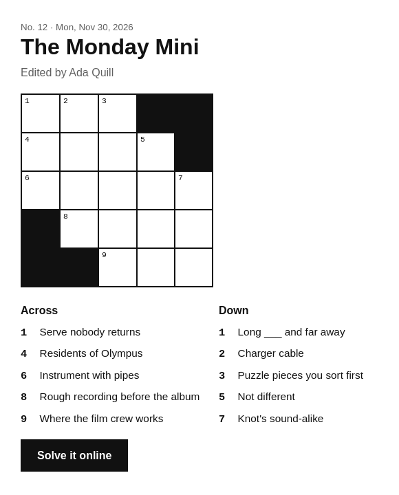
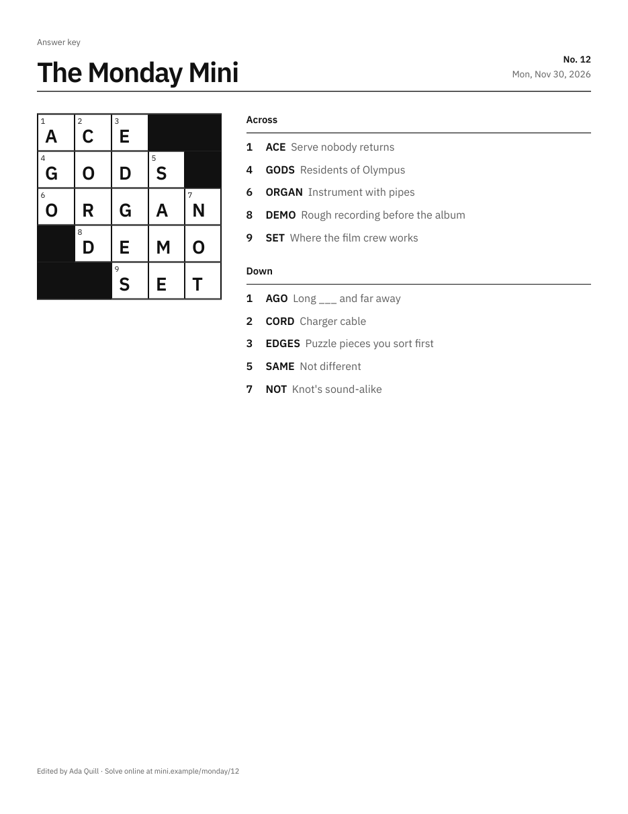

# Crossword Kit

A newsletter crossword that actually works in an inbox. Write the puzzle once as a grid of letters and ten clues, and get:

- **An email** where the grid is real table cells, so it draws the same in classic Outlook, Gmail and Apple Mail, with a "Solve it online" button
- **A print PDF**: the puzzle on page one, the answer key on page two
- **A share card** (1080 × 1350 PNG and SVG) for a group chat or a story

All three are built with [Hyper Elements](https://hyperelements.dev) (`@hyper-elements/react`) and share one grid element.

| Email, classic Outlook | Email, Gmail app | PDF puzzle | PDF answer key | Share card |
|---|---|---|---|---|
|  |  |  |  |  |

The email screenshots come from Hyper Elements' email-client emulator (`@hyper-elements/email-clients`).

## Why

Most newsletter puzzles are a screenshot and a link, because a crossword is hard to build in email: no CSS grid, no absolute positioning, and Outlook draws with Word. A grid of table cells is the one layout every client agrees on. The hard part is the little clue number in each square's corner, and that holds up in every client tested.

## Write a puzzle

```ts
// src/data.ts
grid: ["ACE##", "GODS#", "ORGAN", "#DEMO", "##SET"],
clues: {
  across: { 1: "Serve nobody returns", 4: "Residents of Olympus", /* … */ },
  down:   { 1: "Long ___ and far away", 2: "Charger cable", /* … */ },
},
```

`#` is a block. You never number anything: `src/grid.ts` numbers the squares the standard way (a square starts an entry when the square before it is a block or the edge), and reads each answer out of the grid. A clue can't point at the wrong square, and the answer key can't disagree with the puzzle. Any rectangular grid works, not only 5 × 5.

## How Hyper Elements is used

| Feature | Where | What it does here |
|---|---|---|
| `defineTheme` | `src/theme.ts` | One theme for all three outputs: black and white, IBM Plex, one blue |
| Shared component | `src/elements.tsx` | `CrosswordGrid` is `Table`, `TableRow` and `TableCell`, sized by one `cell` prop: 56px in email, 88px in the PDF, 48px on the answer key, 160px on the card |
| `Email` | `src/email.tsx` | 600px email: grid, clues in two columns (stacked on phones), button |
| `validate` + `emailClients()` | `scripts/render-email.tsx` | Checks the email against 11 clients |
| `renderInEmailClients` | `scripts/render-email.tsx --preview` | Previews in classic Outlook, the Gmail app and Apple Mail |
| `Document` + `PageBreak` + `renderPdf` | `src/pdf.tsx`, `scripts/render-pdf.tsx` | Two Letter pages, with a `PageFooter` on each |
| `Canvas` + `renderImage` | `src/card.tsx`, `scripts/render-card.tsx` | The share card as PNG and SVG |

### What the client checks found

`validate` finds no errors. The notes: classic Outlook draws the button with square corners and skips the heading's letter spacing, and web fonts fall back to Arial and Courier New in Outlook and Gmail. The grid itself needs nothing removed in any client: borders collapse, block squares fill, numbers stay top left.

## Run it

Requires Node 20 or later.

```bash
git clone https://github.com/cipoklean/crossword-kit.git
cd crossword-kit
npm install

npm run render          # PDF, email and card into out/
npm run preview:email   # also writes email-client previews to out/email/previews/
```

| Command | Writes |
|---|---|
| `npm run render:email` | `out/email/crossword.email.html` and `.txt` |
| `npm run preview:email` | The above, plus one HTML preview per client. Open them in Chrome or Chromium |
| `npm run render:pdf` | `out/crossword.pdf`, `out/crossword.print.html` |
| `npm run render:card` | `out/crossword-card.png`, `out/crossword-card.svg` |

## Project layout

```
src/
  types.ts      Puzzle, Clue, Square
  data.ts       "The Monday Mini" No. 12
  grid.ts       numbering and answer reading
  theme.ts      the shared theme
  elements.tsx  CrosswordGrid, used by all three outputs
  email.tsx     Email root
  pdf.tsx       Document root
  card.tsx      Canvas root
scripts/        one render script per output
fonts/          IBM Plex Sans and Mono (SIL OFL 1.1)
out/            rendered outputs, committed so you can look without installing
docs/           README screenshots
```

## Licence

Code: MIT. Fonts: IBM Plex, SIL Open Font License 1.1. The puzzle, its editor and the solve URL are made up.
